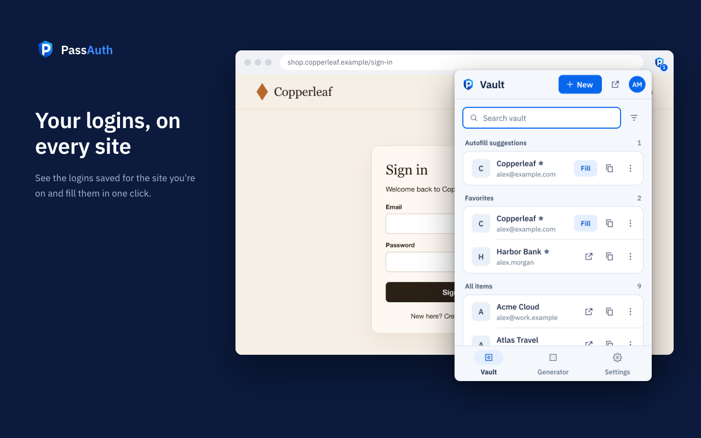

<p align="center"></p>

<h1 align="center">PassAuth</h1>

<p align="center">A password manager you host yourself.<br>Logins, verification codes and passkeys, encrypted on your devices and synced through your own server.</p>

<p align="center">
  <a href="CHANGELOG.md"></a>
  <a href="https://github.com/Fahed-Alhammadi/PassAuth/releases/latest"></a>
  <a href="https://chromewebstore.google.com/detail/passauth/pnofinkalfnjjgofaikljeikjaoogaan"></a>
  <a href="https://github.com/Fahed-Alhammadi/PassAuth/actions/workflows/core.yml"></a>
  <a href="LICENSE"></a>
</p>

<p align="center">
  <a href="https://fahed-alhammadi.github.io/PassAuth/">Website</a> ·
  <a href="docs/SELF_HOSTING.md">Self-hosting guide</a> ·
  <a href="docs/ARCHITECTURE.md">Security design</a> ·
  <a href="https://fahed-alhammadi.github.io/PassAuth/support.html">Support</a>
</p>

<p align="center"></p>

## Why PassAuth

- **Your server, your data.** One small container with the web vault built in. SQLite by default, PostgreSQL if you prefer.
- **Zero knowledge.** Items are encrypted on your device. The server never sees your master password and can't read your vault, including item names and website addresses.
- **Everything in one place.** Logins, verification codes, passkeys, cards, identities and notes.
- **Made for sharing.** Share vaults with family or a team; each vault key is sealed to each member.
- **Easy to switch.** Import exports from other password managers, read and encrypted in your browser.
- **Works offline.** The extension and the apps keep an encrypted copy of your vault on the device, so you can unlock it and fill logins when your server is out of reach.
- **Yours to take with you.** Export your vault at any time, and print an Emergency Kit (Settings → Account) with what you need to get back in: your server's address, your email and your Secret Key.
- **Strong passwords.** A generator for passwords and passphrases, with the EFF word list, in every app.

## Apps

| App | What it does | Get it |
|---|---|---|
| Web vault | Manage items, share vaults, import, two-step login, admin page | Built into every server |
| Browser extension | Menu under login fields and autofill, codes copied for you, saves new logins, passkeys, offline copy, up to five accounts, badge with the logins for the open site | [Chrome Web Store](https://chromewebstore.google.com/detail/passauth/pnofinkalfnjjgofaikljeikjaoogaan) (Chrome, Edge, Brave and other Chromium browsers) |
| Desktop | Your vault on macOS, Windows and Linux; lives in the menu bar or tray, syncs in the background, updates itself; AutoFill for Safari and apps on macOS | [Downloads](#desktop-app) below |
| Android | Autofill in apps and browsers, passkey provider, verification codes (scan or paste), password history, live and background sync | Beta: [join the group](https://groups.google.com/g/passauth-app), then [join the test on Google Play](https://play.google.com/apps/testing/io.passauth.app) |
| iPhone and iPad | AutoFill for passwords, codes and passkeys; saves new logins and suggests strong passwords; password history, live and background sync | Beta: [join the test on TestFlight](https://testflight.apple.com/join/MGBhGbhp) |

Browsers: the extension runs in Chrome, Edge, Brave and other Chromium browsers. Safari is covered by the macOS AutoFill extension that comes with the desktop app. Firefox isn't supported.

The mobile apps aren't in the stores yet. To try them before the official release, join the beta from the links above; you'll get updates automatically. On Android, first join the [passauth-app Google Group](https://groups.google.com/g/passauth-app) with the Google account you use on your phone, then open the Google Play link. Feedback is welcome in [GitHub Issues](https://github.com/Fahed-Alhammadi/PassAuth/issues).

### Desktop app

The desktop app is the web vault in its own window. It remembers your server's address, your email and your Secret Key on the machine, never your master password. The vault locks after the time you choose; if you choose "Never", the key material is kept in the system keychain (Windows: Credential Manager) so the vault opens without the master password.

- Lives in the menu bar (macOS) or system tray (Windows, Linux), can start at login and keeps running when you close the window. On macOS the Dock icon is optional.
- Syncs in the background every 2 hours by default; change it in Settings → Account → "This app".
- Opens `otpauth://` links ("Set Up Codes In" on macOS) to add a verification code to a login.
- Checks for updates once a day and asks before installing.

**AutoFill on macOS.** The app includes an AutoFill extension for Safari and apps (macOS 14 or later): turn on PassAuth in System Settings → General → AutoFill & Passwords. It fills passwords, passkeys and one-time codes, and unlocks with your master password or Touch ID for the time you choose. It reuses the desktop app's server address, email and Secret Key, so you only type the master password once. Its settings include "Default URI match detection" (base domain, host, starts with, exact, regular expression or never). It doesn't clear the clipboard on macOS.

- macOS (Apple silicon and Intel): [PassAuth-macOS.dmg](https://github.com/Fahed-Alhammadi/PassAuth/releases/latest/download/PassAuth-macOS.dmg)
- Windows (64-bit): [PassAuth-Windows-x64-setup.exe](https://github.com/Fahed-Alhammadi/PassAuth/releases/latest/download/PassAuth-Windows-x64-setup.exe)
- Linux (x86_64): [PassAuth-Linux-x86_64.AppImage](https://github.com/Fahed-Alhammadi/PassAuth/releases/latest/download/PassAuth-Linux-x86_64.AppImage), or [.deb](https://github.com/Fahed-Alhammadi/PassAuth/releases/latest/download/PassAuth-Linux-amd64.deb) for Debian and Ubuntu and [.rpm](https://github.com/Fahed-Alhammadi/PassAuth/releases/latest/download/PassAuth-Linux-x86_64.rpm) for Fedora and openSUSE

Updates: the app checks GitHub for new versions once a day and asks before installing. Every version is on the [releases page](https://github.com/Fahed-Alhammadi/PassAuth/releases). The macOS app is signed and notarized, so it opens without warnings. Windows shows a SmartScreen warning on first run until the builds are code-signed; choose "More info" → "Run anyway".

## Install the server

You need a machine with Docker and Docker Compose, and a domain with HTTPS to use PassAuth from other devices.

```bash
git clone https://github.com/Fahed-Alhammadi/PassAuth.git passauth
cd passauth
cp .env.example .env          # then set DOMAIN in .env
mkdir -p data && sudo chown 1000:1000 data   # owned by your PUID:PGID
docker compose up -d
```

Put it behind HTTPS (the apps require it), open your domain and create your account. The [self-hosting guide](docs/SELF_HOSTING.md) covers every step: the admin token, email, HTTPS with a reverse proxy, updates, backups and all settings.

To update: `docker compose pull && docker compose up -d`. Database changes apply on start. What changed in each version: [CHANGELOG.md](CHANGELOG.md).

## Security

- **Sign-in:** OPAQUE, so your master password is never sent to the server. Guessing it from stolen server data is slowed by Argon2id, and blocked if you turn on the Secret Key. Two-step login by authenticator app, email code, security key or passkey (WebAuthn, web vault), or recovery code.
- **Keys:** Argon2id from your master password, optionally mixed with a 128-bit Secret Key that never leaves your devices.
- **Encryption:** every item has its own key and is sealed with XChaCha20-Poly1305, bound to its item and vault.
- **Sharing:** vault keys are sealed to each member's X25519 key; fingerprints let you confirm who you share with.
- **Server:** runs as a non-root user on a read-only filesystem with no extra Linux capabilities.

The full design is in [docs/ARCHITECTURE.md](docs/ARCHITECTURE.md). To report a vulnerability, see [SECURITY.md](SECURITY.md).

## Import

In the web vault, open **Import** and choose the export file from your old password manager. JSON (including password-protected), CSV, `.1pux` and KDBX exports are supported. Files are read and encrypted in your browser; nothing unencrypted reaches the server. Supported formats: [docs/IMPORT_FORMATS.md](docs/IMPORT_FORMATS.md).

## Develop

The Rust core (crypto and importers) is shared by every client: compiled to WebAssembly for the web vault and extension, and bound through UniFFI for the mobile apps.

| Path | What |
|---|---|
| `crates/core` | Crypto, item format, importers |
| `crates/server` | API server (axum, sqlx) that also serves the web vault |
| `web/` | Web vault (React, Vite) |
| `extension/` | Chrome extension (Manifest V3, TypeScript) |
| `desktop/` | Desktop app (Tauri: Rust shell + the web vault) |
| `android/`, `ios/` | Mobile apps (Kotlin/Compose, SwiftUI) |

```bash
cargo test --workspace                       # crypto, importers and server API tests
scripts/build-wasm.sh web/src/wasm && (cd web && pnpm install && pnpm build)
scripts/build-wasm.sh extension/src/wasm && (cd extension && pnpm install && pnpm build)
scripts/build-wasm.sh web/src/wasm && (cd web && pnpm install) && (cd desktop && pnpm install && pnpm tauri dev)   # desktop app
docker compose up -d --build                 # build and run the image locally
```

Requires Rust (stable, with the `wasm32-unknown-unknown` target), `wasm-bindgen-cli` matching the version in `Cargo.lock`, Node.js 26 and pnpm. The desktop app also needs the Tauri 2 system dependencies: the Xcode command line tools on macOS, WebView2 on Windows and webkit2gtk on Linux.

To try an extension build, open `chrome://extensions`, turn on **Developer mode**, click **Load unpacked** and choose `extension/dist`.

The server, the extension, the desktop app and the two mobile apps each have their own version (five parts). Server versions are published as the Docker image `ghcr.io/fahed-alhammadi/passauth`, with their changes in [CHANGELOG.md](CHANGELOG.md); the desktop app as [GitHub releases](https://github.com/Fahed-Alhammadi/PassAuth/releases) tagged `vX.Y.Z`, which the installed app updates from; the extension and the mobile apps through their stores.

## Support

Questions and bug reports: [GitHub Issues](https://github.com/Fahed-Alhammadi/PassAuth/issues). Please don't include passwords, codes or other vault contents. More help: [support page](https://fahed-alhammadi.github.io/PassAuth/support.html).

## License

PassAuth is released under the [MIT License](LICENSE).

Third-party components keep their own licenses:

- The passphrase word list is the [EFF Large Wordlist](https://www.eff.org/dice) by the Electronic Frontier Foundation, licensed under [CC BY 3.0 US](https://creativecommons.org/licenses/by/3.0/us/).
- The web vault, extension and website use the [IBM Plex](https://github.com/IBM/plex) fonts, licensed under the [SIL Open Font License 1.1](https://openfontlicense.org).
- Rust and JavaScript dependencies are under their own licenses (mostly MIT or Apache-2.0); see `Cargo.lock` and the `pnpm-lock.yaml` files.

© 2026 Fahed Alhammadi. All rights reserved.
